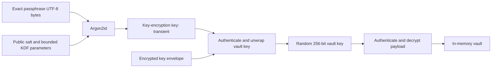

# Architecture

Status: Phase 5 lifecycle and usability implemented, 2026-10-08. `Packages/CryptaCore` provides crypto, parsing, persistence, and typed models. The root `CryptaDesktop` package contains SwiftUI features, the observable presentation model, and macOS adapters; `Crypta.xcodeproj` builds the app bundle. See [Phase 4 evidence](Documentation/PHASE_4_RESULTS.md) and [Phase 5 evidence](Documentation/PHASE_5_RESULTS.md) for implemented behavior and remaining release checks.

## Decisions and trade-offs

| Concern | Decision | Reason and cost |
| --- | --- | --- |
| Platform | macOS 14+, Apple Silicon initially | A practical SwiftUI/Observation baseline; test the oldest supported OS before release. Core format is independent of OS. |
| Language | Swift 6 with strict concurrency | Explicit isolation for keys, saves, and lifecycle transitions. |
| Library | libsodium, with a narrow Swift adapter | Supplies both required primitives and secure memory utilities; brings a native dependency and artifact provenance obligations. |
| KDF | Argon2id v1.3, explicit parameters | Memory-hard offline guessing defense. No use of a changing library default algorithm. |
| AEAD | XChaCha20-Poly1305, combined mode | 256-bit keys, 192-bit random nonces, 128-bit authentication tags. No counter shared across copied vaults. |
| Keys | Random data key wrapped under passphrase-derived key | Rewrapping avoids payload encryption on passphrase changes. Old copies remain relevant to compromise recovery. |
| Payload | Whole-vault encrypted UTF-8 JSON | Easy to audit and migrate; memory and save cost scale with vault size. No compression or attachments in v1. |
| Persistence | Encrypted staging file and atomic replacement | Crash consistency requires durable writes as well as rename; filesystem behavior matters. |

### CryptoKit compared with libsodium

| Capability | Apple CryptoKit | libsodium |
| --- | --- | --- |
| AES-256-GCM | Native supported AEAD | Available, but not selected |
| Argon2id | No public Argon2id API in the assessed surface; another dependency is needed | Supported |
| XChaCha20-Poly1305 | CryptoKit's ChaChaPoly is not XChaCha20 | Supported |
| Portability | Excellent Apple integration; non-Apple use requires another implementation | Cross-platform C library with Swift integration |
| Integration cost | Apple-managed system dependency | Must pin, inspect, and maintain the package/native binary |
| Secret buffers | Swift object lifetimes still need care | Guarded allocations and explicit wiping are available; Swift copies remain a limitation |

CryptoKit AES-GCM plus libsodium Argon2id is a viable alternative, but it still needs libsodium and splits the crypto boundary across two libraries. Select libsodium for both operations. XChaCha's larger nonce space suits independent copies and random nonces; it does not promise mathematically impossible collisions. Never intentionally reuse a nonce under a key. This is established envelope encryption using library primitives, but Crypta's container composition still requires independent review. It is not an audited protocol merely because libsodium implements its primitives.

Primary references: [CryptoKit](https://developer.apple.com/documentation/cryptokit), [AES.GCM](https://developer.apple.com/documentation/cryptokit/aes/gcm), and [libsodium XChaCha20-Poly1305](https://doc.libsodium.org/secret-key_cryptography/aead/chacha20-poly1305/xchacha20-poly1305_construction). Packaging evidence is in [DEPENDENCIES.md](Documentation/DEPENDENCIES.md).

## Key management



Creation generates independent random vault ID, 32-byte vault key, 16-byte salt, and two 24-byte nonces. Call `sodium_init()` successfully before any crypto operation. Derive a 32-byte key-encryption key with explicit `crypto_pwhash_ALG_ARGON2ID13`; wrap the vault key; encrypt the payload; persist only the complete encrypted container. Clear derived key and passphrase buffers promptly.

Initial proposed KDF profile: 256 MiB, three passes, one lane, Argon2 version 0x13. Store exact integers. Benchmark on an M1 under memory pressure before freezing the profile; target roughly 0.5–2 seconds as a usability goal, not a measured result or security guarantee. Never reduce parameters automatically after allocation failure. Permit only the bounded profiles in the format specification. libsodium's API uses a single lane; do not mislabel this as RFC 9106's four-lane profile. See [libsodium KDF guidance](https://doc.libsodium.org/password_hashing/default_phf) and its [Argon2id implementation](https://raw.githubusercontent.com/jedisct1/libsodium/1.0.22-RELEASE/src/libsodium/crypto_pwhash/argon2/pwhash_argon2id.c).

Unlock validates public structure and resource limits before Argon2, authenticates the key envelope, then authenticates the complete payload before JSON decoding. No partial plaintext reaches callers. Release the passphrase and derived key after unlock. Retain only the vault key and decoded model while unlocked. Save requires the vault key, not a cached master passphrase or derived key.

Passphrase changes first flush committed changes and resolve any external-file conflict. Derive from the supplied current passphrase, authenticate its envelope, and compare the unwrapped key with the session key using a constant-time comparison. Generate a fresh salt and wrap nonce, derive from the new passphrase, and replace only the key-slot descriptor and wrapped key in a complete atomically written file. Preserve the payload bytes exactly. Update session state only after a successful commit. A failure leaves the old file and old credentials usable.

**Rewrapping does not revoke old copies.** An attacker who recovers the unchanged vault key from an old copy can decrypt later payloads they acquire. Compromise recovery needs a new vault with a new random key and re-encrypted contents, plus rotation of exposed stored credentials. Old backups cannot be remotely revoked.

### Passphrase byte policy

Use exact UTF-8 bytes, without trimming, normalization, case folding, or a terminating NUL. Pass explicit byte lengths to C; embedded U+0000 is data, not a terminator. Confirm creation/change passphrases using byte equality: Swift `String` equality alone can equate canonically equivalent Unicode sequences. Visually identical NFC and NFD inputs may intentionally derive different keys. Test this distinction and explain it in help.

Reject an empty passphrase on creation; recommend long randomly selected words without claiming length guarantees entropy. Permit spaces and Unicode. A disclosed resource cap of 1 MiB of UTF-8 bytes prevents pathological allocations; never truncate. Unlock must use the bytes supplied, without applying future creation-strength rules.

## Package and application boundaries

Proposed structure; these directories and targets will be created in their implementation phases:

```text
Crypta.xcodeproj
CryptaApp/
  App/                    # scene, commands, lifecycle and composition
  Features/
    Welcome/ VaultCreation/ VaultUnlock/
    VaultBrowser/ EntryEditor/ Settings/
  Presentation/           # main-actor MVVM, display-only state
  Platform/               # panels, bookmarks, clipboard, sleep and activity
Packages/CryptaCore/
  Package.swift
  Sources/CryptaCore/
    Domain/               # vault, entry variants, tags, validation
    Services/             # vault session actor, transactions
    Security/             # sodium adapter and owned sensitive buffers
    Format/               # bounded v1 binary codec, payload JSON codec
    Persistence/          # encrypted byte I/O, conflicts, atomic commit
  Tests/CryptaCoreTests/
    SecurityTests/ FormatTests/ PersistenceTests/ DomainTests/
    Fixtures/             # public, synthetic vectors only
CryptaAppTests/
Documentation/
```

`CryptaCore` may use Foundation and libsodium. It must never import SwiftUI, AppKit, Keychain, or Secure Enclave to decrypt. Platform adapters grant file access to the core; bookmarks help locate files but never become key material. No global singleton vault or persistent decrypted model cache.

The implemented `VaultEngine` actor owns key lifetime and serializes operations. Use a bounded worker for synchronous KDF work, off the main actor, with one derivation in flight. Actor reentrancy and cancellation must not allow stale unlock/save completions to resurrect a locked session: use a session generation identifier and check it before publishing results. Cancellation may not interrupt native Argon2 midway; dispose of its result when it completes. Keys stay within their owning operation/session, rather than passing raw buffers through UI tasks.

Inject only boundaries needed for tests: randomness, file operations/failure points, monotonic clock, and clipboard adapter. Production randomness always comes from libsodium; deterministic test RNGs cannot be enabled by an app setting.

## Domain model

Vault metadata, timestamps, entries, tags, Favorites, URLs, and field display preferences all live inside the encrypted payload. Entries have UUIDs, created/modified dates, a type discriminator and type version. Typed variants cover credentials, tokens, notes, and custom fields. Tags are flat strings stored on entries, with case-insensitive identity. Favorites is an entry Boolean. Sidebar navigation consists of All Items, Favorites, and used tags; selecting several tags requires every selected tag. Custom fields have their own UUID, name, value, and `isSecret` display flag. That flag never changes encryption.

Search occurs only in memory while unlocked, over titles, usernames/services, and tags. Do not index secrets through Spotlight or persist search strings. Unsupported payload schemas/types and unknown fields fail safely before a session opens; they cannot be silently dropped on save. The implemented API returns `Vault` snapshots with an engine-owned revision. Successful saves return the next revision; stale snapshots fail. Domain constructors are usable for editing, while the engine boundary performs full validation. Schema-1 categories are validated and converted to tags on authenticated reads. Schema-2 writes omit categories and category references. Bulk tag changes and Favorites use the same atomic save operation as entry edits.

## UI and lifecycle

Use a three-column `NavigationSplitView`, accessible field labels, system typography, keyboard navigation, and standard file panels. Start with create/open actions; do not persist recent paths in the first UI milestone. Hide secret fields by default. Provide Command-N for a new vault when closed, Command-O for open, Command-S for save, Command-F for search, Command-E for editing, Command-Shift-P for passphrase changes, and Command-Shift-L for lock. Confirm destructive entry deletion. Keep secure-field values out of accessibility labels until explicitly revealed.

Editor drafts are transient. An explicit Save performs an encrypted atomic transaction; only a successful commit becomes accepted model state. The editor remains open on save failure and offers retry or save an encrypted conflict copy, never overwrite-by-default. Show an ongoing notice that unsubmitted drafts are discarded on automatic lock. Explicit lock/quit can offer Save, Discard, or Cancel for a draft. Auto-lock/sleep must not wait indefinitely for a dialog or filesystem; immediately obscure the UI and discard unsubmitted drafts. A commit already in progress may finish while the session is closing, then wipe its key; no UI data is republished. The UI must accurately mark a transaction saved only after durable commit.

Default inactivity timeout: five minutes; choices one, five, fifteen, thirty minutes, or disabled. Measure app-local user input using a monotonic clock, not mouse position or background saves. Sleep and explicit lock remain enabled when inactivity locking is disabled. Check elapsed inactivity on foreground/resume and before displaying secrets. Clear editor bindings, selection, search, revealed fields, undo state, decoded models, and owned key buffers on lock. Termination releases the session; forced termination can lose unsubmitted work.

Clipboard default: clear after 30 seconds; configurable to 15/30/60/120 seconds or only on lock. Use a local/concealed pasteboard option where supported, retain ownership/change-count metadata instead of retaining the secret solely for a timer, and clear only if the pasteboard still represents Crypta's exact write. Clear on lock under the same ownership check. A new write with identical text by another app is still not ours. Detailed limitations appear in [SECURITY.md](SECURITY.md).

## Implemented application boundary

`VaultViewModel` is main-actor isolated and talks to an injectable `VaultService`; production uses the existing `VaultEngine` actor. Plaintext snapshots and editor drafts are caller-owned. Successful encrypted saves replace the snapshot and clear the draft. Ordinary errors leave the committed model and draft intact; ambiguous post-rename failures lock and require inspection. Generation tokens suppress late results after lock. Lock clears displayed data synchronously, cancels the operation, waits for it to finish, then locks the core. Folder grants stay alive through this sequence.

The app uses native panels and explicitly requests the enclosing folder because the persistence implementation needs sibling staging/lock files. It retains no bookmarks. App Sandbox grants only user-selected read/write access, with no network entitlement. A single window and single vault keep ownership explicit. AppKit-backed inputs disable undo, spelling, substitutions, completion, and writing tools where supported; Swift/SwiftUI/AppKit copies still cannot be proven erased.

`SessionSecurity` owns deadlines and pasteboard ownership metadata, with injected clock and pasteboard adapters for deterministic tests. `AppSecurityMonitor` connects a common-mode timer, app-local input events, and workspace sleep/session notifications. Timing starts before unlock/create work and does not reset on completion. Two validated timeout integers are the only security preferences persisted locally.

Passphrase-change drafts are separate transient objects. Exact UTF-8 confirmation is checked before calling the core, input bindings are cleared before starting the operation, and failures require re-entry. The existing encrypted transaction rewraps the key while preserving payload ciphertext. Settings and passphrase forms use accessible labels; AppKit inputs apply pending focus after attachment to a window, including secure fields and Command-F search requests.
